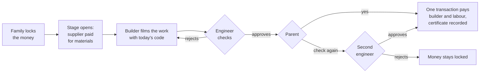
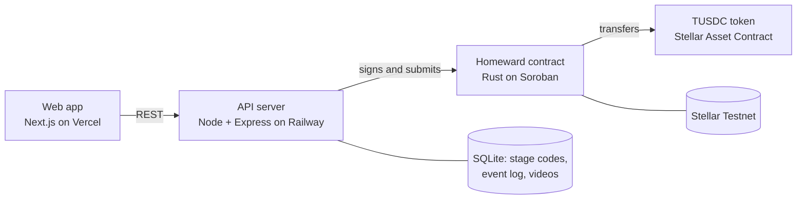

# Homeward

**Pay for your parents' house from abroad, one checked stage at a time.**

Families abroad send money home to build or fix a house for their parents, then can't see what happens to it. Homeward locks that money in a smart contract on Stellar and releases it stage by stage. A stage is paid only after an independent engineer checks the work and the parent living in the house says yes.

Built for the Blockchain Innovation Challenge powered by Stellar (University of Waterloo Velocity, November 2026), Problem Space 3: Cross-Border Remittances.

| | |
|---|---|
| **Live app** | https://homeward-ecru.vercel.app |
| **Guided tour** (play every role yourself) | https://homeward-ecru.vercel.app/demo |
| **60-second demo video** | [docs/showcase/video/homeward-demo.mp4](docs/showcase/video/homeward-demo.mp4), with [the 12 Testnet transactions it shows](docs/showcase/video/README.md) |
| **Contract on Stellar Testnet** | [`CC2NYVUTHJWBRTDG7J4O6VB7TINL5MTNOTTXOMVMHKSCUYZR4W3M6QF2`](https://stellar.expert/explorer/testnet/contract/CC2NYVUTHJWBRTDG7J4O6VB7TINL5MTNOTTXOMVMHKSCUYZR4W3M6QF2) |
| **One-pager** | [docs/homeward-one-pager-v1.pdf](docs/homeward-one-pager-v1.pdf) |
| **Showcase board** | [docs/showcase/homeward-board.jpg](docs/showcase/homeward-board.jpg) |

## Contents

- [The problem](#the-problem)
- [How a stage gets paid](#how-a-stage-gets-paid)
- [Who does what](#who-does-what)
- [What is real and what is simulated](#what-is-real-and-what-is-simulated)
- [How it is built](#how-it-is-built)
- [The contract](#the-contract)
- [The API](#the-api)
- [The web app](#the-web-app)
- [Run it yourself](#run-it-yourself)
- [Tests](#tests)
- [What it costs](#what-it-costs)
- [Limits we know about](#limits-we-know-about)
- [What is next](#what-is-next)
- [Team](#team)

## The problem

Families abroad sent ₹2,16,893 crore home to Kerala in 2023, and renovating houses and shops is the largest listed use of that money (Kerala Migration Survey 2023). Sending it takes seconds. Seeing what happens to it, from 13,500 km away, is the hard part.

In August 2026 a Wayanad consumer commission ruled on a house where about ₹34.5 lakh had been paid and the house was left unfinished and leaking (reported by the Indian Express). The money had gone out before anyone independent looked at the work. Once concrete covers bad steel, it can't be fixed.

A bank transfer ends when the money lands. A bank escrow holds money but doesn't check a wall. Homeward ties the payment to the check.

## How a stage gets paid

A build is split into stages, such as foundation, walls, roof slab, finishing and handover. Each stage has a fixed amount and fixed payees.



1. **Lock.** Family members abroad fund the build. Every fee is shown before they pay.
2. **Open.** When a stage opens, the supplier is paid for materials, and a new one-time code is made for that stage.
3. **Film.** The builder films the work showing the code, so old footage can't be reused. Only a fingerprint (hash) of the video goes on-chain.
4. **Check.** An independent engineer reviews it. The contract refuses anyone who pays, builds, supplies or gets paid on the build as its engineer.
5. **Yes, or check again.** The parent approves, or asks for a second check. A second check blocks payment until a second engineer rules.
6. **Pay.** One approval pays the builder and labour in a single transaction and records a stage certificate.

If things go wrong, the family or the parent can freeze the build, and nothing pays while it is frozen. Unspent money goes back to each family member in proportion to what they paid in. A builder's deposit, held by the contract, comes back after handover or goes to the family after a confirmed default.

## Who does what

| Role | In the story | What they can do |
|---|---|---|
| Family abroad (sponsor) | Anil in Toronto, Meera in the UAE | Fund the build, ask for a second check, freeze, report a stalled builder |
| Parent | Amma, who lives in the house | Approve a stage, ask for a second check, freeze |
| Builder | Thomas | Post a deposit, send proof for each stage, contest a report |
| Engineer | Assigned per stage | Approve or reject that stage |
| Supplier and labour | | Receive payments only |
| Homeward (admin) | | Create a build, open stages, assign engineers, settle a frozen or disputed build |

## What is real and what is simulated

**Real on Stellar Testnet:** creating a build, funding, opening stages, supplier payment, proof fingerprints, engineer and parent approvals, the second check, split payouts, certificates, the builder's deposit and held-back payments, reporting a builder who stopped, freezing and refunds. Every step in the demo video is a transaction you can look up.

**Simulated:** Interac and UAE bank transfers in, rupee payouts, text messages, identity checks, engineer licences, site photos and the site camera. The money is a test dollar token (TUSDC), shown in rupees at a fixed demo rate.

**Demo shortcuts:** our server holds the key for every role and signs for them, so one person can play the whole story. Our admin account can settle a frozen build. An AI check of the uploaded video only helps the engineer; a person decides.

The hosted app is connected to the backend and runs on Testnet. Run the web app locally without `NEXT_PUBLIC_API_URL` and it uses demo data in the browser.

## How it is built



| Part | Stack | Job |
|---|---|---|
| Contract | Rust, Soroban SDK | Holds the money, checks every rule, pays all payees for a stage in one call |
| API server | Node 22, TypeScript, Express, SQLite | Signs for each demo role, creates stage codes, stores and hashes videos, keeps an event log |
| Web app | Next.js 16, React, TypeScript | Family, parent, builder and engineer screens. It only calls the API; no keys in the browser |
| Client bindings | Generated TypeScript | Typed calls from the server to the contract |
| Scripts | TypeScript, tsx | Testnet accounts, the end-to-end demo, deposit and attack runs |

**On-chain:** who is on the build, stage amounts and payees, approvals, payouts, certificates, and fingerprints of each video and engineer report.
**Off-chain:** the video itself, the plain stage code, names, and anything that identifies a person.

**Why a contract and not a normal app:** a normal app can only record a decision, and whoever runs it can change it. The contract enforces the decision, and anyone can read both the rules and the transactions.

### Repo layout

| Folder | What it is |
|---|---|
| `contracts/homeward` | The Soroban contract and its 50 tests |
| `packages/homeward-client` | TypeScript bindings generated from the contract |
| `backend` | The API server ([its own README](backend/README.md) covers settings and limits) |
| `web` | The Next.js app |
| `scripts` | Testnet account setup, the end-to-end demo, deposit and attack runs |
| `docs` | Demo video and its transaction list, one-pager, engineer price quotes, demo limits |

## The contract

One contract, in `contracts/homeward/src`. Amounts are `i128` with 7 decimals, never floats.

| Area | Functions |
|---|---|
| Setting up | `create_project`, `assign_inspector` |
| Money in | `fund` (takes the amount plus the 1.5% fee; the fee goes to Homeward at once, the rest stays for the build) |
| A stage | `open_stage` (pays the supplier), `submit_proof`, `decide`, `recheck`, `release` |
| Stopping a build | `freeze`, `resolve` |
| Builder's deposit | `post_deposit`, `return_deposit` |
| A builder who stops | `claim_default`, `confirm_default`, `contest_default`, `withdraw_claim`, `finalize_default`, `settle_default` |
| Reading | `get_project`, `get_stage`, `get_certificate`, `get_claim`, `contribution`, `fee_credit`, `config` |

Rules the contract enforces, each with a test:

- Every state-changing call requires the acting address to sign, and checks that address's role.
- Payees, stage amounts and the builder's terms are fixed when the build is created and can't be changed.
- It can never pay out more than was funded. A test checks the contract holds exactly the unspent money plus deposit and retention.
- There is no admin withdraw. The only money that reaches Homeward is the fee at funding.
- An engineer can't be someone with a stake in the build, a second engineer must be a different person, and an engineer can't be swapped once proof is in.
- Payee shares must add up to 100%, and any rounding goes to the last payee.
- After a second check is requested, the stage needs two engineers' approval.
- A frozen build pays nobody.

## The API

The web app talks only to this server. Every write returns the transaction hash and a Stellar Expert link.

| Route | What it does |
|---|---|
| `GET /api/health` | Server status |
| `GET /api/projects`, `GET /api/project/:id` | Builds, with stages, contributions and certificates |
| `GET /api/timeline/:id` | Event history with explorer links |
| `POST /api/project` | Create a build (admin) |
| `POST /api/fund` | A family member funds the build |
| `POST /api/stages/:stage/open` | Open a stage, pay the supplier, create the code |
| `POST /api/stages/:stage/proof` | Builder uploads a video; its hash goes on-chain |
| `POST /api/stages/:stage/decide` | Engineer or parent approves or rejects |
| `POST /api/stages/:stage/recheck` | Parent or family asks for a second engineer |
| `POST /api/stages/:stage/release` | Pay out once approved and any hold time has passed |
| `POST /api/project/:id/freeze`, `/resolve` | Stop a build and refund what is unspent |
| `POST /api/project/:id/deposit`, `/return-deposit` | The builder's deposit |
| `POST /api/project/:id/default/...` | Report, confirm, contest, withdraw, finalise or settle a stalled build |

A public demo server gets abused, so requests are rate-limited per caller, settling a dispute needs an admin key, and free test money is capped. Details are in [backend/README.md](backend/README.md).

## The web app

| Screen | For | What it shows |
|---|---|---|
| Family | Sponsors | The build, what is locked and spent, every fee, funding, the certificate timeline |
| Parent | Amma | One question per stage: yes, or check again. Large text and a listen button |
| Builder | Thomas | Today's code, video upload, deposit and payments |
| Engineer | Assigned engineer | The video, a checklist, approve or reject |
| Guided tour (`/demo`) | Anyone | Plays the story step by step, switching roles for you |
| Proof (`/proof`) | Anyone | The transaction record |
| Price (`/price`) | Anyone | What a build would cost, from the engineer quotes |

The main screens avoid the words wallet, token, gas and blockchain. A family sees locked, paid, check again and certificate.

## Run it yourself

**Prerequisites:** Node 22.13 or newer, Rust 1.84 or newer with the `wasm32v1-none` target, and the [Stellar CLI](https://developers.stellar.org/docs/tools/cli).

**Web app only** (uses demo data, no keys needed):

```bash
cd web
npm install
npm run dev     # http://localhost:3000
```

**Contract:**

```bash
cd contracts/homeward
cargo test                # 50 tests
stellar contract build
```

**The whole story on Testnet:** copy `.env.example` to `.env` in the repo root and fill in your own Testnet keys (`scripts/accounts.ts` creates and funds a set). Then:

```bash
./scripts/demo.sh         # fund, open, proof, approve, split pay, second check, reject
./scripts/security.sh     # the builder's deposit: it comes back, or goes to the family
./scripts/attack.sh       # calls that should fail, and do
```

**API server:**

```bash
cd packages/homeward-client && npm install && npm run build
cd ../../backend && npm install
npm start                 # http://localhost:4000/api/health
```

Then set `NEXT_PUBLIC_API_URL=http://localhost:4000` for the web app.

Never commit a real `.env`. Only `.env.example` is in the repo, and the keys in it are blank.

## Tests

| Where | Command | What it covers |
|---|---|---|
| Contract | `cargo test` in `contracts/homeward` | 50 tests: setup, funding, engineer rules, proof, approval and split pay, hold times, the second check, freeze and refund, the builder's deposit, and stalled-build reports |
| Web app | `npm test` in `web` | The app's project logic |
| API server | `npm test` in `backend` | Request limits and the admin guard |
| API on Testnet | `npm run smoke` in `backend` | Every route against Testnet (about 10 minutes) |

CI runs the contract, backend and web checks on every pull request.

## What it costs

- Homeward's fee is **1.5%** of what the family locks, charged when they fund. On a ₹15 lakh build that is ₹22,500.
- The fee pays for the engineer's video reviews. Eight Kerala engineers quoted ₹500 to ₹1,200 per review ([docs/engineer-quotes.md](docs/engineer-quotes.md)).
- Site visits for work that concrete will hide are priced separately; our estimate is ₹2,000 to ₹3,000 plus travel.
- Break-even is about 200 builds a year on ₹30 lakh builds with a small team. Only the review prices are quotes; the other inputs are our assumptions.

## Limits we know about

The full list, with the file and function for each, is in [docs/technical-limits.md](docs/technical-limits.md). The main ones:

- The contract proves who approved, not that the work is good. It controls who may release money.
- Homeward picks the engineers, so an admin and an engineer working together could approve bad work. The parent's right to a second engineer is the check on that.
- The admin decides how a frozen build's unspent money is split. That should be an independent party.
- The server holds every role's key in this demo. In a real product each person signs for themselves.
- History comes from our own event log, not an independent indexer.
- No family has paid the fee yet, and we have not asked builders. We interviewed 15 engineers and one family.

## What is next

1. A pilot with ten families who pay from their own bank, with Homeward holding no money.
2. A licensed payment partner for bank transfers in and rupee payouts.
3. Each person signing for themselves, with passkeys rather than seed phrases.
4. An independent party to settle disputes, and an expiry on reports.
5. An indexer that reads events from the chain.

## Team

Ved Agwekar (technical lead, backend, presenter), Youdis Acharya (contract and backend), Krishneet Singh (web app, Devpost, video), Rivan Dutta (product, research, pitch). University of Waterloo.

Licensed under the [MIT License](LICENSE).
